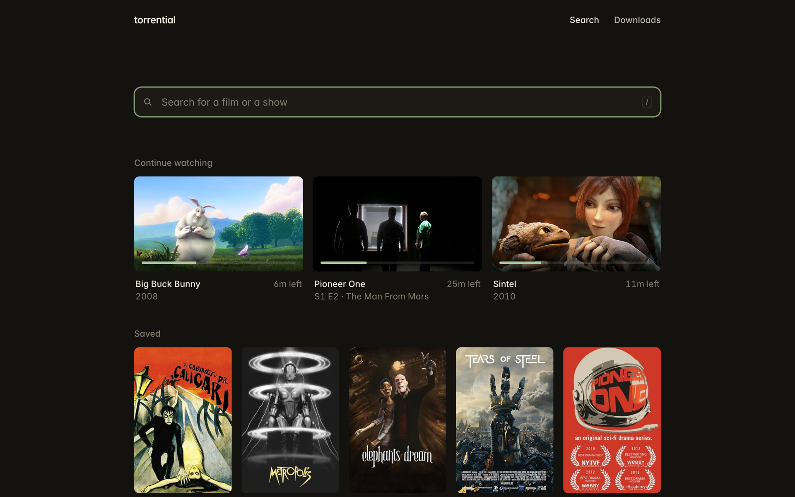
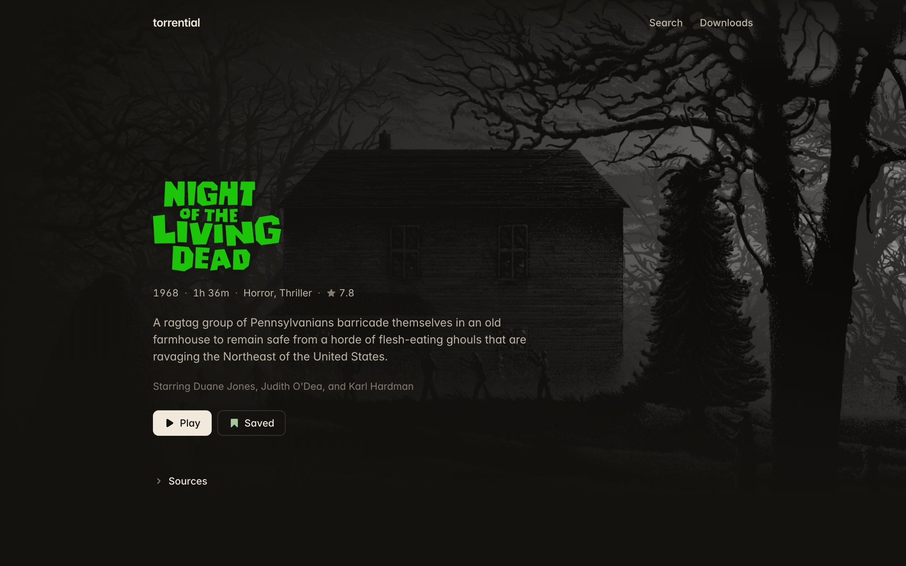
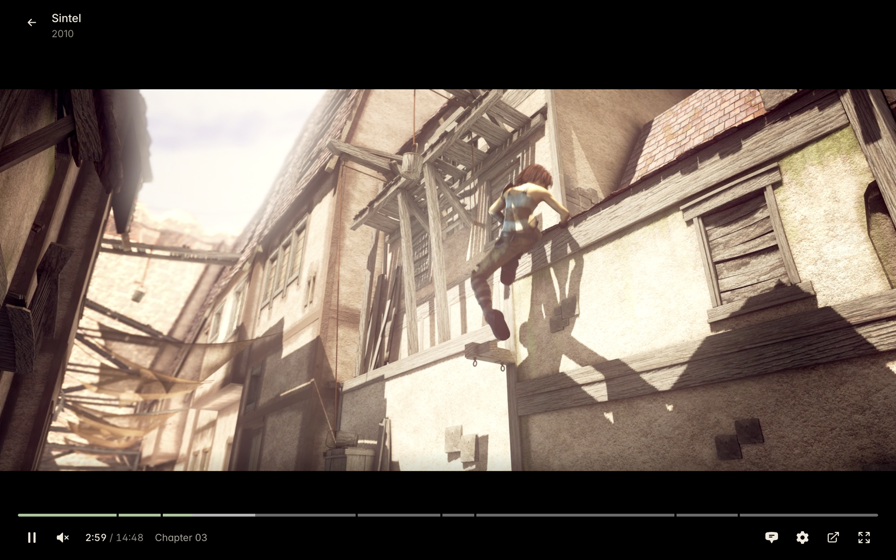

<h1 align="center">torrential</h1>

<p align="center">Find a film or a show, press Play, and watch it while it downloads. From your browser, your terminal, or your coding agent.</p>

<p align="center">
  
</p>

## Install

```sh
curl -fsSL https://raw.githubusercontent.com/nexxeln/torrential/main/install.sh | sh
```

This puts one file at `~/.local/bin/torrential`. It runs on macOS 14 or later on Apple silicon, and on 64-bit Linux.

<details>
<summary>Build from source</summary>

With Rust and Nix, with flakes turned on:

```sh
git clone --recursive https://github.com/nexxeln/torrential
cd torrential
nix develop -c cargo install --path crates/torrential
```

</details>

## In your browser

```sh
torrential web
```

Search by name and you get one card for each film or show, not a list of torrents. Press Play. torrential picks the torrent that suits your screen and language, checks that it starts, and moves to the next one when it does not. A torrent that gets no data is taken off your downloads again. One that got some, or that you watched part of, is kept. Playing a title never deletes a file or writes over one you already have.

<p align="center">
  
</p>

It plays while it downloads. Jump anywhere and torrential fetches that part first. It remembers where you stopped in each film and episode, and Play continues there, even from another torrent. Subtitles come from the file, or are found online when it has none.

<p align="center">
  
</p>

To choose a torrent yourself, open Sources on any title. The plain torrent search is one click away, for everything that is not a film or a show.

Browsers cannot read every format. Install [ffmpeg](https://ffmpeg.org) (`brew install ffmpeg`) and torrential converts MKV files and surround sound as you watch.

## In your terminal

Run `torrential` to open the terminal UI. It opens on what you were watching and the titles you saved, finds films and shows by name, and plays them. Press `d` for your downloads:

<p align="center">
  
</p>

Or run the commands yourself:

```sh
torrential titles night of the living dead   # find a film or a show
torrential play tt0063350                    # watch it in IINA, mpv, or VLC
torrential play tt1748166 s01e02             # or one episode
torrential get tt0063350                     # download it to keep

torrential search arch linux iso             # or search every torrent
torrential get 9b5212 --files '*.iso'        # and download only the files you want
torrential status                            # list your downloads
```

`torrential --help` lists the rest. Every command takes `--json`.

## With your agent

```sh
torrential skill install
```

This teaches Claude Code, Codex, Gemini CLI, Cursor, and other agents to use torrential. Then ask in plain words, such as "play Night of the Living Dead" or "download the latest Arch Linux ISO". Downloads run in a background engine, so they continue after the agent's session ends.

## Settings

Results are ranked for your screen, CPU, and language. `torrential setup` shows what it found and lets you change it.

Film and show details come from Cinemeta and IMDb. Everything else is in `~/.config/torrential/config.yaml`:

```yaml
downloads:
  dir: ~/Downloads/torrents   # default: a torrential folder in Downloads
player: mpv                   # for torrential play: iina, mpv, vlc, or a path
subtitles:
  online: false               # do not look for subtitles online
catalog:
  online: false               # do not look up films and shows online
updates: notify               # say when a new version is out instead of installing it, or off
```

The engine starts when you log in and keeps running. It installs new versions in the background and starts them once nothing is playing. `torrential engine uninstall` stops it starting at login.

## It never seeds

torrential never uploads a piece, and a download stops as soon as it finishes. It puts lawful sources such as archive.org first among equal matches. Download only what you have the right to.

## License

MIT. See [LICENSE](LICENSE).
