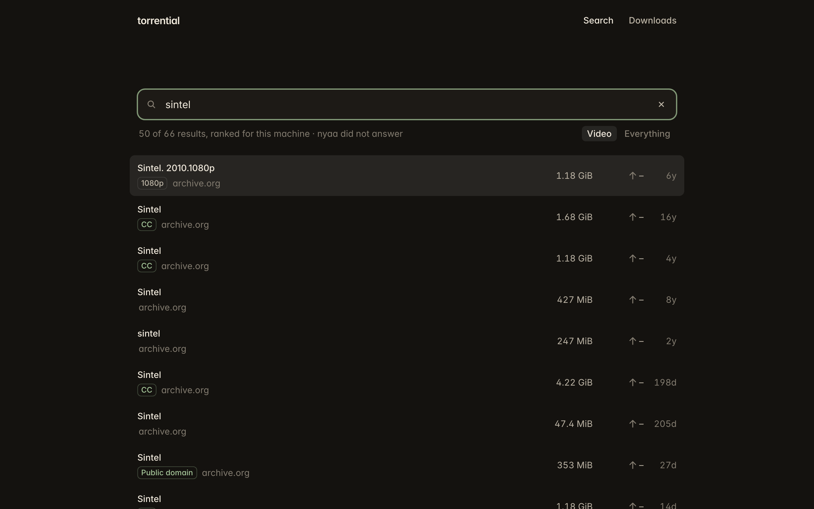

<h1 align="center">torrential</h1>

<p align="center">Search torrents and watch them while they download, from your browser, your terminal, or your coding agent.</p>

<p align="center">
  
</p>

## Install

```sh
curl -fsSL https://raw.githubusercontent.com/nexxeln/torrential/main/install.sh | sh
```

This puts one file at `~/.local/bin/torrential`. It runs on macOS 14 or later on Apple silicon, and on 64-bit Linux.

<details>
<summary>Build from source</summary>

With Rust and Nix, with flakes turned on:

```sh
git clone --recursive https://github.com/nexxeln/torrential
cd torrential
nix develop -c cargo install --path crates/torrential
```

</details>

## In your browser

```sh
torrential web
```

Search, pick a result, and it plays while it downloads. Jump anywhere and torrential fetches that part first. Subtitles come from the file, or are found online when it has none, and you can shift them when they are out of sync.

<p align="center">
  
</p>

Browsers cannot read every format. Install [ffmpeg](https://ffmpeg.org) (`brew install ffmpeg`) and torrential converts MKV files and surround sound as you watch.

## In your terminal

Run `torrential` to open the terminal UI:

<p align="center">
  
</p>

Or run the commands yourself:

```sh
torrential search big buck bunny         # each result starts with a short ID
torrential get fd69b2 --files '*.mp4'    # download only the files you want
torrential play fd69b2                   # watch in IINA, mpv, or VLC while it downloads
torrential status                        # list your downloads
```

`torrential --help` lists the rest. Every command takes `--json`.

### Finding music inside a release

Torrent indexes usually search release titles, not the names of every track inside an album or compilation. An empty artist-and-track search does not establish that the track is unavailable.

For music you have permission to download, use `--category audio`. If the track query is empty, try the album title or artist, then inspect a candidate with `torrential files <id>` before selecting files with `--files`. An artist-only result is a release candidate, not confirmation that it contains the requested track or remix. Broad artist names can also match unrelated artists.

Check the recording and version separately from the download: original, radio edit, live performance, mixed compilation track, and remix can share most of their title. `torrential verify` checks the torrent's data against its piece hashes; it does not establish a recording's artist or remix identity. A metadata timeout also leaves the file contents unknown.

## With your agent

```sh
torrential skill install
```

This teaches Claude Code, Codex, Gemini CLI, Cursor, and other agents to use torrential. Then ask in plain words, such as "download the public-domain film Night of the Living Dead, one MP4 only". Downloads run in a background engine, so they continue after the agent's session ends.

## Settings

Results are ranked for your screen, CPU, and language. `torrential setup` shows what it found and lets you change it.

Everything else is in `~/.config/torrential/config.yaml`:

```yaml
downloads:
  dir: ~/Downloads/torrents   # default: a torrential folder in Downloads
player: mpv                   # for torrential play: iina, mpv, vlc, or a path
subtitles:
  online: false               # do not look for subtitles online
updates: auto                 # install new versions by itself, or off
```

## It never seeds

torrential never uploads a piece, and a download stops as soon as it finishes. It puts lawful sources such as archive.org first among equal matches. Download only what you have the right to.

## License

MIT. See [LICENSE](LICENSE).
