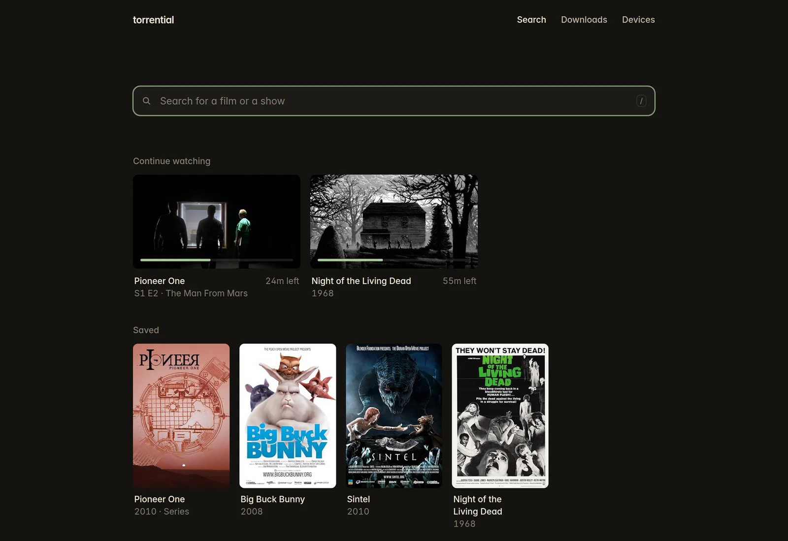
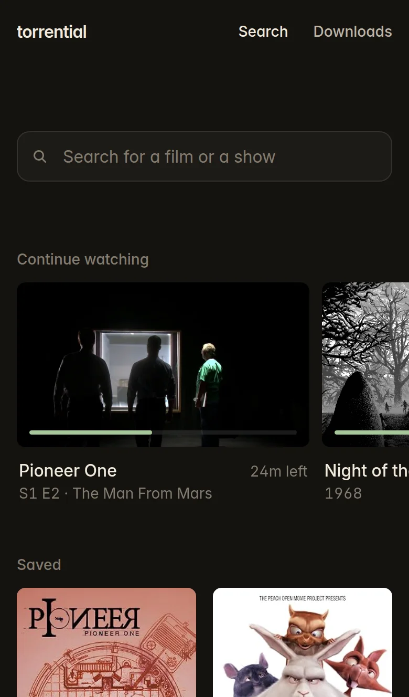
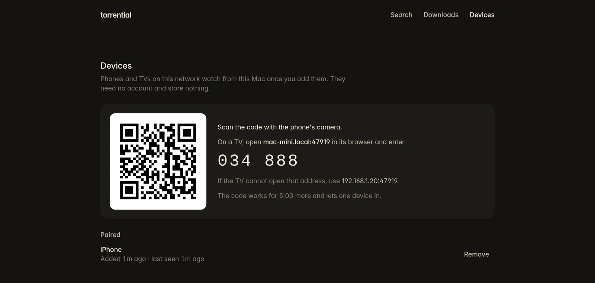
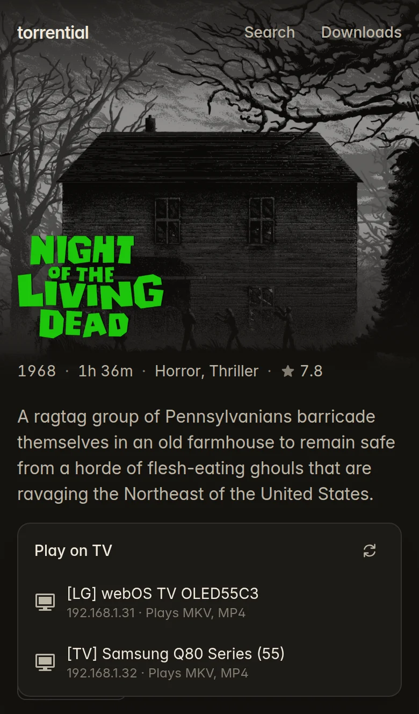

<h1 align="center">torrential</h1>

<p align="center">Your Mac is the library, and every screen in the house plays from it. Find a film or a show, press Play, and watch it while it downloads.</p>

<p align="center">
  
  
</p>

## Install

```sh
curl -fsSL https://raw.githubusercontent.com/nexxeln/torrential/main/install.sh | sh
```

The script puts one file at `~/.local/bin/torrential`. torrential runs on macOS 14 or later on Apple silicon, and on 64-bit Linux.

The engine starts at login and keeps running, so your phone and TV can always reach it. It resumes downloads after a restart and installs updates when nothing is playing. To stop it starting at login, run `torrential engine uninstall`.

<details>
<summary>Build from source</summary>

You need Rust, and Nix with flakes turned on.

```sh
git clone --recursive https://github.com/nexxeln/torrential
cd torrential
nix develop -c cargo install --path crates/torrential
```

</details>

## Watch on the Mac

```sh
torrential web
```

Search by name. Each film or show is one card, not a list of torrents. Press Play. torrential picks the torrent that suits your language and the screen you watch on, and moves to the next one if it does not start. While you watch, the film gets the bandwidth before other downloads.

What you play goes to a folder that only torrential uses, capped at 20 GiB. When it fills, torrential deletes the plays you watched longest ago, but never the film you watched last or a title you saved. When you remove a download you started yourself, its files go to the Trash.

torrential converts MKV files and surround sound for the browser with [ffmpeg](https://ffmpeg.org), and fetches ffmpeg the first time a file needs it.

## Add a phone or a TV

<p align="center">
  
</p>

On the Mac, open **Devices** and choose **Add a device**, or run `torrential devices add`. On a phone, scan the QR code. On a TV, open the address in its browser and enter the code. The device needs no account and stores nothing. The web app works with a touch screen and with a TV remote. A device you did not add sees the pairing page and nothing else.

## Play on TV

<p align="center">
  
</p>

LG, Samsung, Sony, and most other smart TVs play over DLNA. On a title page, on the Mac or a phone you added, choose **Play on TV** and pick the TV. The phone then works as the remote. torrential sends the TV only copies in a format it plays.

```sh
torrential tv                    # list the TVs on the home network
torrential tv play tt0063350     # play a film on the TV
torrential tv seek 1:02:30       # or pause, resume, volume, and stop
```

## In your terminal

Run `torrential` to open the terminal UI on what you were watching and the titles you saved. Press `/` to find a film or a show, and Enter to open or play it in IINA, mpv, or VLC. Press `d` to see your downloads.

Or run the commands yourself:

```sh
torrential titles night of the living dead   # find a film or a show
torrential play tt0063350                    # watch it in IINA, mpv, or VLC
torrential play tt1748166 s01e02             # or one episode
torrential get tt0063350                     # download it to keep

torrential search arch linux iso             # or search every torrent
torrential get 9b5212 --files '*.iso'        # and download only the files you want
torrential status                            # list your downloads
```

`torrential --help` lists the rest. Every command takes `--json`.

### Finding music inside a release

Torrent indexes usually search release titles, not the names of every track inside an album or compilation. An empty artist-and-track search does not establish that the track is unavailable.

For music you have permission to download, use `--category audio`. If the track query is empty, try the album title or artist, then inspect a candidate with `torrential files <id>` before selecting files with `--files`. An artist-only result is a release candidate, not confirmation that it contains the requested track or remix. Broad artist names can also match unrelated artists.

Check the recording and version separately from the download: original, radio edit, live performance, mixed compilation track, and remix can share most of their title. `torrential verify` checks the torrent's data against its piece hashes; it does not establish a recording's artist or remix identity. A metadata timeout also leaves the file contents unknown.

## With your agent

```sh
torrential skill install
```

The skill teaches Claude Code, Codex, Gemini CLI, Cursor, and other agents to use torrential. Then ask in plain words, such as "play Night of the Living Dead on the TV" or "download the latest Arch Linux ISO".

## Settings

`torrential setup` shows the screen and language torrential found on the Mac and lets you change them. Film and show details come from Cinemeta and IMDb. Set everything else in `~/.config/torrential/config.yaml`:

```yaml
downloads:
  dir: ~/Downloads/torrents   # default: a torrential folder in Downloads
plays:
  max: 50GiB                  # what plays may take up, default 20GiB
player: mpv                   # for torrential play: iina, mpv, vlc, or a path
subtitles:
  online: false               # do not look for subtitles online
catalog:
  online: false               # do not look up films and shows online
ffmpeg:
  fetch: false                # do not fetch ffmpeg when it is not installed
updates: notify               # say when a new version is out instead of installing it, or off
```

## It never seeds

torrential never uploads a piece, and a download stops as soon as it finishes. It puts lawful sources such as archive.org first among equal matches. Download only what you have the right to.

## License

MIT. See [LICENSE](LICENSE).
